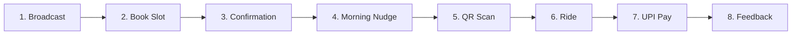

# 🚲 Campus Cycles — Campus Mobility MVP Prototype

> **A lean, zero-friction micro-mobility service for university campuses.**  
> Validating student commute demand between hostels and academic blocks using scheduled batch booking, low-tech operations, and instant UPI payments.

---

## 📌 Executive Summary

**Campus Cycles** is an operational and product experiment designed to solve the daily last-mile commute challenge on university campuses. Long walks between student residential hostels and academic blocks lead to fatigue, schedule delays, and low energy for morning lectures. 

Rather than building expensive native mobile apps, custom hardware, or GPS-locked docking stations upfront, this **Minimum Viable Product (MVP)** tests core business hypotheses using a hyper-lean stack:
* **WhatsApp Broadcasts** for demand generation & nudges (no app download barrier).
* **Scheduled Batch Bookings** (evening cutoff at 9:00 PM) enabling manual fleet rebalancing overnight.
* **Simple QR Stickers** on cycle handlebars (no IoT smart locks or GPS hardware needed).
* **UPI Pay-per-use** (₹10/ride placeholder) to validate student willingness to pay.
* **1-Tap Fatigue Score** (*"How drained do you feel?"*) to measure real-world value delivery.

This repository hosts a **self-contained, interactive clickable prototype** demonstrating the full end-to-end user journey and operational model inside a simulated mobile phone frame with step-by-step coach guidance.

---

## 🎯 Problem Statement & Target Market

### The Problem
* **Distance & Physical Fatigue**: Walking 1–2 km between hostels and classrooms under harsh weather (sun, heat, or rain) leaves students physically drained before lectures start.
* **Inefficiency of Personal Bicycles**: Purchasing, maintaining, locking, and repairing personal bikes brings high friction, theft risks, and rust during semester breaks.
* **Peak-Hour Bottlenecks**: High demand surges occur during narrow time windows (e.g., 8:30 AM morning classes, 5:30 PM evening dispersal). Conventional dockless rental systems suffer from severe spatial fleet imbalance (all cycles end up at one end of campus).

### The Target Route & Users
* **Route**: Hostel Zone (Hostel B) ⇄ Academic Block
* **Target Audience**: 240+ campus students needing reliable, predictable transit during peak morning and evening class shifts.

---

## 💡 Lean MVP Methodology

In accordance with Lean Startup and Design Thinking principles, the objective is to **validate value and growth hypotheses with minimum capital expenditure**:

```
Traditional Approach (High CapEx)                Campus Cycles MVP (Lean)
---------------------------------                ------------------------
Native iOS/Android App           ───►  WhatsApp Broadcasts + Web Form
Expensive Smart GPS Locks        ───►  Physical QR Stickers on Handlebars
Complex In-App Wallet System     ───►  Direct UPI Instant Payment Links
Autonomous Redistribution Fleets ───►  Scheduled Batch Windows + Caretaker Rebalancing
```

---

## 🔄 End-to-End User Journey (8 Prototype Steps)

The clickable prototype simulates the full cycle of a student's daily commute:



### 1. 📢 Evening Broadcast (7:30 PM)
* **Channel**: WhatsApp Broadcast Group (240 students).
* **Content**: Next day's available slots (Morning 8:30 AM / Evening 5:30 PM) and live cycle availability at stands (Hostel: 8, Academic: 7).
* **Call to Action**: *"Book tomorrow's cycle"* before 9:00 PM.

### 2. 📝 Batch Booking Form
* **Interface**: Lightweight, pre-filled web form.
* **Inputs**: Commute direction (*Hostel ➔ Academic* vs. *Academic ➔ Hostel*) and preferred slot time.
* **Operational Benefit**: Provides advance demand forecasting so campus caretakers know exactly how many cycles to rebalance overnight.

### 3. ✅ Instant Booking Confirmation
* **Message**: Automated WhatsApp reply confirming the reservation at the departure stand.
* **Promise**: Sets clear expectations that a dedicated cycle is guaranteed with a scheduled leave-by time.

### 4. ⏰ Morning Nudge & Honest Wait Estimate (8:05 AM)
* **Message**: Personalized alert sent 15 minutes before the leave-by window (*"Leave by 8:20 AM"*).
* **Transparency**: Shows real-time stand counts (*"Cycles there now: 6, 1 is yours"*), removing anxiety about vehicle availability.

### 5. 📷 QR Code Scan at Stand
* **Action**: Student arrives at the stand and scans the QR code sticker on the cycle handlebar (e.g., `Cycle #07`).
* **Mechanism**: Verifies check-out timestamp and vehicle identity without costly telematics.

### 6. 🚴 Ride in Progress
* **Interface**: Active ride screen with real-time digital timer and stylized SVG route tracking from Hostel to Academic block.
* **Return Instructions**: Clear reminder to return the cycle to either designated stand upon arrival.

### 7. 💳 Pay-per-Use Settlement
* **Summary**: Displays ride duration, vehicle wait time (0 min), and a nominal fare (₹10 sample price).
* **Payment**: Frictionless UPI settlement (no proprietary wallet or deposit required).

### 8. 📊 Value Metric: Fatigue Feedback
* **Question**: *"How drained do you feel?"* on a 1–5 scale (1 = Fresh, 5 = Drained).
* **Metric**: Measures whether eliminating the walk preserved student energy for learning, providing quantitative validation of the core value proposition.

---

## 🧪 Product Hypotheses & Validation Framework

| # | Hypothesis | Metric (KPI) | Validation Benchmark |
|---|------------|--------------|----------------------|
| **H1: Demand** | Students are willing to book cycles the prior evening rather than relying on ad-hoc availability. | Booking conversion rate from broadcast; slots filled before 9 PM. | > 70% of available fleet booked by 9:00 PM. |
| **H2: Reliability** | Pre-allocating cycles and sending leave-by nudges eliminates wait time and no-show friction. | No-show rate; student wait time at departure stand. | < 5% no-shows; 0-minute wait time for reserved users. |
| **H3: Willingness to Pay** | Students will pay ₹10/ride for a fast, guaranteed commute over a free 15-minute walk. | Payment completion rate via UPI per completed trip. | > 90% payment compliance without gate locks. |
| **H4: Value Delivered** | Cycling significantly reduces physical exhaustion compared to walking. | Post-ride fatigue score (Scale 1–5). | Average score ≤ 2.0 ("Fresh / Low fatigue"). |
| **H5: Fleet Balance** | Overnight and midday caretaker rebalancing based on booking data prevents station dry-outs. | Stand stock-out incidents during peak windows. | 0 stock-outs during scheduled slots. |

---

## 🖥️ Interactive Prototype Features

The `index.html` file contains a fully functional, self-contained interactive prototype with:

* **Dual-Pane Layout**:
  * **Interactive Phone Simulator** (Right): 372×720px bezel frame displaying live status bar, WhatsApp messaging interface, form elements, QR scanner, running timer, and payment summaries.
  * **Observer Companion Panel** (Left): 8-step navigation list, contextual design rationale for each screen, and a one-click reset trigger.
* **Guided Walkthrough (Coach Mode)**: Pulsating amber rings (`.hint`) and coach instructions highlight the exact action required at each step.
* **Live Step-Jumping**: Observers and testers can click any step in the sidebar to jump directly to that state in the prototype.
* **Adaptive Timers & Dynamic Route State**: Active ride timer dynamically updates ride duration and reflects it on the checkout and completion screens.
* **Accessible & Responsive**:
  * Built using semantic HTML5 and ARIA labels.
  * Honors `prefers-reduced-motion` settings.
  * Responsive mobile breakpoint collapsing down cleanly for smaller viewport screens.

---

## 🛠️ Technology Stack & Design System

The prototype is built strictly with zero external runtime dependencies:

* **Core**: Pure HTML5 & Vanilla ES6+ JavaScript.
* **Styling**: Vanilla CSS3 using custom properties (CSS variables) for design token consistency.
* **Typography**: Clean system UI font stack (`Segoe UI`, system-ui, Apple-system, Roboto).

### Color Palette Tokens
| Token | Hex / Value | Purpose |
|-------|-------------|---------|
| `--teal` | `#2A9D8F` | Primary brand accent & active CTA buttons |
| `--teal-d` | `#1C7A6E` | Dark teal for headers, active text, and hover states |
| `--teal-s` | `#E2F3F0` | Soft teal for badges, selection chips, and tags |
| `--amber` | `#E9A23B` | Coach dot and attention-grabbing focus rings |
| `--ink` | `#1E2A38` | Primary text and phone chassis border |
| `--mute` | `#5E6B7A` | Secondary text, captions, and step counters |
| `--bg` | `#F3F6F9` | Neutral background canvas |
| `--chat` | `#ECE7DF` | WhatsApp-style chat canvas |
| `--sent` | `#DDF2E3` | User-sent chat bubble tone |

---

## 🚀 Quick Start / How to Run

No installations, Node.js packages, or build steps are required. 

### Method 1: Direct File Launch (Easiest)
Simply double-click [`index.html`](file:///c:/Users/pavit/Documents/MBA/2025/PROJECTS/campus-mobility/index.html) or open it directly in any modern browser:
```bash
# Windows
start index.html

# macOS
open index.html

# Linux
xdg-open index.html
```

### Method 2: Local HTTP Server (Optional)
If you prefer running via a local development server:

* **Python 3**:
  ```bash
  python -m http.server 8000
  ```
  Then visit `http://localhost:8000`.

* **Node.js (`npx serve`)**:
  ```bash
  npx serve .
  ```

* **VS Code / IDE**:
  Right-click `index.html` and choose **"Open with Live Server"**.

---

## 📁 Repository Structure

```text
campus-mobility/
├── index.html        # Complete interactive prototype (UI, styles, state engine)
└── README.md         # Detailed project documentation & MBA business context
```

---

## 📈 Next Steps & Operational Roadmap

* [ ] **Phase 1: Manual Pilot (Current)**
  * Run a 2-week pilot with 15 refurbished cycles on the Hostel B ⇄ Academic block route.
  * Coordinate bookings via manual Google Form + WhatsApp Broadcast list.
  * Caretaker manually logs cycle IDs and reconciles UPI payments against a shared spreadsheet.
* [ ] **Phase 2: Semi-Automated Messaging Bot**
  * Integrate WhatsApp Business API / Twilio bot to automate booking confirmations and leave-by reminders.
  * Automated payment verification via UPI QR payment hooks.
* [ ] **Phase 3: Scaling & Hardware Optimization**
  * Expand to 4 hostel zones and library hub with 50+ cycles.
  * Pilot Bluetooth low-energy (BLE) smart locks for automated check-in/check-out.
  * Introduce weekly and semester subscription passes based on pilot willingness-to-pay findings.

---

## 👥 Authors & Academic Context

* **Project**: Campus Mobility Innovation & Entrepreneurship Project (MBA 2025)
* **Focus Area**: Sustainable Campus Transportation, Micro-mobility, Lean Startup Operations.
* **Repository**: [https://github.com/pavitrapoojary/campus-mobility](https://github.com/pavitrapoojary/campus-mobility)
